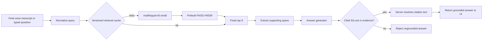

# Measured RAG architecture

SubaRAG optimizes the latency that users feel, while preserving a strict rule:
an answer is valid only when its citations resolve to retrieved evidence.



## Serving path

1. Treat the final normalized transcript as the query. Typed input enters at the
   same boundary; transcription is never repeated during a query retry.
2. Use `intfloat/multilingual-e5-small` with its required `query:` and `passage:`
   prefixes and normalized embeddings.
3. Load a checksum-verified, prebuilt HNSW artifact. A Space must never embed the
   full corpus during startup.
4. Retrieve eight passages from the language-appropriate index. Dense retrieval
   is the default; BM25, fusion, adaptive-k, and reranking are outside this path.
5. Extract a small number of query-relevant sentences while retaining the source
   document ID on every span.
6. Give the generator only those evidence spans. It returns answer text and cited
   document IDs—not citation text or arbitrary URLs.
7. Resolve citations from trusted evidence on the server. Missing or unknown IDs
   fail closed instead of producing an uncited answer.

`GroundedRagEngine` implements this trust boundary. Gemini 3.5 Flash-Lite is the
selected first generator: it passed the corrected frozen multilingual gate while
the local Qwen candidate failed its supported-answer contract and latency gate.
The application should enable the grounded engine only when both verified
retrieval artifacts and the Gemini key are configured; partial configuration
must continue to fail closed.

## Offline artifact path

```text
pinned MSMARCO-XI revision
  -> validated document/evaluation separation
  -> E5 passage embeddings
  -> FAISS HNSW build
  -> documents.jsonl + index.faiss
  -> checksums and versions in retrieval-manifest.json
  -> immutable artifact storage
  -> Hugging Face Space startup load
```

The retrieval manifest records corpus, model, retriever, language, dimension,
document count, file sizes, and SHA-256 checksums. It is written last, so an
interrupted build is never accepted as a valid artifact. Loading verifies every
field before serving queries.

Build one serving artifact per language after the prepared corpus is available:

```sh
cd backend
.venv/bin/subarag-build-index \
  --manifest ../artifacts/corpus/manifest.json \
  --output ../artifacts/index-en \
  --language en
```

For the first portfolio deployment, store prepared/index artifacts separately
from application source and pin their revision. Do not publish derived dataset
artifacts until the upstream redistribution terms have been reviewed.

## Cache and invalidation

Retrieval cache keys contain:

```text
normalized query + language + corpus version + retriever version
```

Changing the corpus, encoder, index parameters, or retrieval policy therefore
cannot reuse stale results. The cache is bounded in memory. Answer caching is a
separate future concern because generation settings, freshness, and safety make
its invalidation rules different.

## Voice behavior

The current transcription endpoint returns a final transcript, so there is no
pretend streaming path. When a provider supplies genuine partials, speculation
may prefetch retrieval only after a stable late partial. The final transcript
must be normalized and compared with the speculative key; a mismatch discards
the work before generation. Numbers, named entities, language changes, and
negation should force invalidation even when general token overlap is high.

## Scaling rules

- Keep HNSW while measured ANN p95 is a negligible fraction of query embedding
  and generation latency.
- Partition immutable artifacts by language and version; scale replicas before
  adding distributed retrieval complexity.
- Measure real 100K and 1M corpora before considering IVF/PQ, ScaNN, sharding, or
  a vector database.
- Optimize the encoder next (batching, quantization, ONNX/OpenVINO, or a hosted
  embedding service) because current traces identify it as the retrieval
  bottleneck.
- Add a reranker only if a multilingual held-out test proves its gain is worth
  its p95 and memory cost.

## Next experiment gate

Before deployment, evaluate the assembled retrieval-plus-generation path on a
larger frozen multilingual set for answer correctness, unsupported-claim rate,
citation precision/recall, no-answer behavior, time-to-first-token, and
end-to-end p50/p95/p99. The isolated generator gate passed, but retrieval quality
or generator quality alone is not the release gate.
